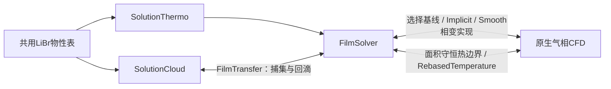

# 喷淋与壁膜扩展库开发说明

本仓库提供八个OpenFOAM Foundation 14扩展库及其共享源码。源码已统一格式并增加中文注释；库的运算标记与整理前一致。独立仓库的构建记录见[验证记录](验证记录.md)。

## 库、源码与依赖

| 动态库 | 源目录 | 主要职责 |
|---|---|---|
| `liblibrSolutionThermo.so` | [librSolutionThermo](../src/librSolutionThermo/) | 浓度相关液体热物性 |
| `libpSpraySolutionCloud.so` | [pSpraySolutionCloud](../src/pSpraySolutionCloud/) | 溶液液滴、扇形注入和逃逸账本 |
| `libpSprayFilmSolver.so` | [pSprayFilm](../src/pSprayFilm/) | 盐输运、膜能量方程和面积守恒热边界 |
| `libpSprayFilmPhaseChange.so` | [pSprayFilmPhaseChange](../src/pSprayFilmPhaseChange/) | 局部反应预测及冻结整步的配对源 |
| `libpSprayFilmTransfer.so` | [pSprayFilmTransfer](../src/pSprayFilmTransfer/) | 捕集、回滴及守恒转移 |
| `libpSprayImplicitFilmPhaseChange.so` | [pSprayImplicitFilmPhaseChange](../src/pSprayImplicitFilmPhaseChange/) | 每次外迭代更新的本构源与隐式修正 |
| `libpSpraySmoothFilmPhaseChange.so` | [pSpraySmoothFilmPhaseChange](../src/pSpraySmoothFilmPhaseChange/) | 隐式修正源及极薄膜激活平滑 |
| `libpSprayRebasedTemperature.so` | [pSprayRebasedTemperature](../src/pSprayRebasedTemperature/) | 气膜温度边界的等价重参数化 |

`src/librThermo/`提供共享物性内核；`src/pSprayInjection/PSprayFlatFanInjection.H`直接编入SolutionCloud。本仓库只提供编入SolutionCloud的共享扇形注入头，Allwmake编译上述八库。



## 单位与守恒符号

内核采用SI单位。`fanHalfAngle`是角度，注入器内部转换为弧度。

| 名称 | 含义与单位 |
|---|---|
| `XLiBr`、`X` | LiBr质量分数，kg/kg；0为纯水 |
| `T`、`Tl`、`Tg` | 温度，K |
| `p`、`pEq` | 绝对压力，Pa；气相只有水蒸气 |
| `alpha`、`delta` | 挤出膜区域的液体体积分数；膜厚m，`delta=alpha*VbyA` |
| `e`、`h` | 比内能与比焓，J/kg；液膜求e，气相求h |
| `phaseMassRate`、`filmMassRate` | 相变体积质量率，kg/(m³·s) |
| `phaseEnergyRate`、`filmEnergyRate` | 相变焓功率密度，W/m³ |
| `ejectionMass`、`ejectionSalt` | 本时间步回滴的液体/盐质量，kg |
| `ejectionEnergy`、`ejectionMomentum` | 本时间步回滴内能J、动量kg·m/s |

相变`massRate>0`为液膜向气相蒸发，膜侧减源、气相加源；负值为水蒸气被液膜吸收。转移水的焓和动量取供体温度和速度。LiBr不挥发，因此盐方程没有相变盐源。

撞膜与回滴先保存广延量，组装方程时再除以单元体积和同一个实际`deltaT`。一个parcel表示`nParticle`个物理液滴，总质量为`p.mass()*p.nParticle()`。回滴字段不是质量率，不能直接与`phaseMassRate`相加。

## librSolutionThermo：组分相关物性

[librSolutionThermo.H](../src/librSolutionThermo/librSolutionThermo.H)把热物性框架的`nil`组分替换为单元/边界真实的X和尾迹标记。[LiBrSolutionMixture.H](../src/librSolutionThermo/LiBrSolutionMixture.H)按查询位置刷新复用的物性对象。

[LiBrThermoTable.H](../src/librThermo/LiBrThermoTable.H)读取`LIBR_WATER_THERMO_V2`表并禁止越界外推。焓采用T-X Hermite插值，其温度/浓度导数来自同一曲面；黏度的浓度项采用解析式，解析稀溶液端的陡峭变化。`pressureData()`返回`ln(pEq)`及其导数。

[LiBrSolutionProperties.H](../src/librSolutionThermo/LiBrSolutionProperties.H)使用共同能量参考：

```text
h(p,T,X) = hEq(T,X) + (p-pEq)/rho
e(T,X)   = h(p,T,X) - p/rho = hEq-pEq/rho
```

显式压力项在e中相消，避免人为引入负的内能压力导数。`The()`采用有界Newton/二分从e反求T；超出能量可表示范围时报错。质量分数范围0—0.65，温度求逆范围278.15—353.15 K。

导热模式为`ASHRAE526RP`或显式标记的`constantForVerification`。真实X≥0.30浓溶液要求T≥293.15 K。极小尾迹仅使用有界导热参考，其真实T、e、rho、X保持原定义。30%以下向纯水导热值的连接属于模型假设。

## SolutionCloud：液滴与扇形注入

[pSpraySolutionCloud.H](../src/pSpraySolutionCloud/pSpraySolutionCloud.H)保留原生Momentum/Thermo/Reacting/Spray继承链。[pSpraySolutionParcel.H](../src/pSpraySolutionCloud/pSpraySolutionParcel.H)新增XLiBr属性，覆盖克隆、流序列化和粒子场读写，使MPI迁移和重启保留浓度。

`calc()`按T、X刷新rho、Cp和mu；rho变化时按相同每滴质量重算直径。原生热积分得到的显热增量再按共同焓参考反求温度。当前扩展要求破碎、雾化、飞行相变和辐射关闭；当前算例的飞行换热也配置为关闭。注册子模型能力与实际启用项是两个层次。

[PSprayFlatFanInjection.H](../src/pSprayInjection/PSprayFlatFanInjection.H)负责平面扇形方向；[PSpraySolutionFanInjection.H](../src/pSpraySolutionCloud/PSpraySolutionFanInjection.H)设置入口溶液状态。

| 字典键 | 含义 |
|---|---|
| `fanDirection`、`fanTangent` | 中心轴与扇面方向，构造时正交化 |
| `fanHalfAngle` | 半角°；例如45°对应总角90° |
| `fanSpeed` | 注入速度m/s，由算例准备时确定 |
| `XLiBr`、`inletTemperature` | 入口质量分数和温度K |
| `surfaceTension` | 表面张力N/m |

采用扇面内均匀角度抽样。流量与粒径分布由原生注入接口和算例输入处理；孔径和流量应在算例侧换算为入口参数；这里采用点源喷射模型。[PSprayBudgetInteraction.H](../src/pSpraySolutionCloud/PSprayBudgetInteraction.H)在原生逃逸重置速度前保存状态，累计逃逸液体、盐、内能和动能，写出时持久化MPI全局账本。

## FilmSolver：盐、内能与尾迹

[pSprayFilm.C](../src/pSprayFilm/pSprayFilm.C)在原生质量预测/修正后更新组分，并求同一时间步的守恒能量方程。物性更新后用保存的`alpha*rho`重算alpha、delta，保持液体质量。

盐对流使用与膜连续性相同的`alphaRhoPhi`；扩散系数为`D*alpha*rho`，采用有界调和面插值。湿-干面无连通液体路径，扩散为零；MPI耦合面采用相同规则。

盐方程包含连续性误差匹配项，其人工盐贡献、尾迹约束贡献和舍入修正分别输出。能量除Fourier导热外，还包括盐扩散通量携带的`∂h/∂X`。极小尾迹能量参考约束通过原方程残差核算人工功率，接受性由独立审计判断。

`correctComposition()`中的T/e调整是下一次非线性求解的初始迭代，保留物理old-time状态，不能当作真实热源或指定最终温度。`postSolve()`输出库存、Qout及空间诊断；底部带与下腔库存重叠，不能重复求和或当作液位。

## FilmTransfer：同一步捕集与回滴

云侧[PSprayCloudFilmTransfer.C](../src/pSprayFilmTransfer/PSprayCloudFilmTransfer.C)只开放`absorb`撞膜模式。反弹和Bai飞溅源码保留来源分支，但构造器拒绝在当前溶液适配器中启用。

膜侧[pSprayFilmCloudTransfer.C](../src/pSprayFilmTransfer/pSprayFilmCloudTransfer.C)在双云共用账本累计液体、盐、相对速度动量和同参考内能。`resetFromCloudFields()`每个timeIndex只清零一次，第二种云不会清除第一种云的贡献。

回滴在云缓存膜状态时由`prepareEjection()`准备，`correct()`本身为空。预留已请求蒸发水量，按`maxEjectionFraction`限制回滴；原生会删除的`nParticle≤0.001`小parcel对应质量留在膜中。只有`ejectionCloud`指定的云取得回滴，避免双云重复取走库存。

新parcel继承膜的T、rho、Cp、X和U，以二次滴径和冻结质量反求`nParticle`。膜侧负源使用相同广延量及实际dt。

## 三种相变实现

| 实现 | 更新频率 | 处理方式 |
|---|---|---|
| `pSprayFilmPhaseChange` | 每个timeIndex一次 | 调用filmReaction，冻结整步局部预测转移量 |
| `pSprayImplicitFilmPhaseChange` | 每次外迭代 | 当前场的本构通量及矩阵隐式修正 |
| `pSpraySmoothFilmPhaseChange` | 每次外迭代 | 同Implicit，加薄膜截止区平滑激活 |

基线的[PSprayFilmReaction.H](../src/pSprayFilmPhaseChange/PSprayFilmReaction.H)在候选dm下保持盐质量，求两相能量约束，再用括区割线/周期二分求双温度Schrage质量残差。dm正为蒸发、负为吸收。它不求空间输运或管壁热惯性，分裂误差应通过CFD时间细化核验。三个目录中的该头字节相同；当前Implicit/Smooth不调用该预测器。

Implicit/Smooth按当前外迭代场计算：

```text
dm/dt = Aeff * 2*beta/(2-beta) / sqrt(2*pi*Rv)
        * [pEq(Tl,X)/sqrt(Tl) - pGas/sqrt(Tg)]
```

随后限制可用液态水、蒸气和最高X=0.65。未限幅时计算压力导数及能量Jacobian近似，限幅处停用原通量导数。`correction(fvm::Sp(...))`围绕当前迭代修正矩阵，在收敛点消失。PIMPLE外迭代仍须独立核验源变化、迭代精度和时间步无关性。

共同参数为`accommodation`、`wetThickness`、`maxFractionChange`、`phaseEnabled`、`phaseStartTime`、`phaseRampDuration`及蒸气Cp/焓参考。smoothstep控制初始化渐启；beta是独立物理适应系数。

Smooth增加`tailTransitionWidth`。低于`numericalTailThickness`关闭相变，过渡区乘`s²*(3-2*s)`，超过该区恢复原湿润面积因子。例如10 nm截止加10 nm过渡宽度对应10—20 nm平滑区；用于具体工况前应检查过渡宽度敏感性。

气相`*VapourFilmSource::correct()`汇总所有接触膜面面积，按面积分配气相单元可用体积，再更新膜源。映射广延质量率、焓功率和动量率，按气相接收面积归一化；映射前后总量须通过守恒检查。膜addSup前须已有本timeIndex的配对更新。

## 气膜热边界与codedMixed

[pSprayConservativeTemperatureFvPatchScalarField.C](../src/pSprayFilm/pSprayConservativeTemperatureFvPatchScalarField.C)按发送/接收面积换算原生coupledTemperature热导和通量，适用于当前一一对应映射面。其它映射拓扑应重新核验总热量。

[pSprayRebasedTemperatureFvPatchScalarField.C](../src/pSprayRebasedTemperature/pSprayRebasedTemperatureFvPatchScalarField.C)区分参考温度Tr与真实混合界面温度Tb：

```text
Tb = f*Tr + (1-f)*(Ti+g/d)
TrNew = Tb
gNew = g + f*d*(Tr-TrNew)/(1-f)
```

该表达保持任意Ti下的温度及法向梯度算子不变。真实温度越界、梯度表达奇异或不变性检查失败时报错。`referenceRebase=false`仅诊断；Min/Max是参考表达的有效范围。

固体侧wall的原生codedMixed由使用者在算例中配置，可按阶段从绝热切换至指定定温。气膜界面扩展位于上述两个库；这些库不求金属管内部热惯性。

## 格式、编译与物性表

根目录`.clang-format`对应clang-format 18.1.8：4空格、Allman大括号、100列，保留include顺序及字符串，识别forAll系列宏。六层云typedef保留原生逐层排版；第三方PatekNative.C与许可证保持原样。

```bash
python3 scripts/check_cpp_format.py --formatter /path/to/clang-format
./Allwmake
```

运行时在膜的mixture字典中指定`tableFile`，在cloud的constantProperties中指定`solutionTable`，二者均指向本仓库`data/librWaterTable.dat`的实际路径。表结构和适用范围见[物性表说明](物性表说明.md)。

编译结果写入本仓库`build/lib`；原生wmake缓存位于各组件Make/$WM_OPTIONS目录，Git忽略所有生成物。源代码格式变化会改变错误宏的诊断行号及二进制哈希，构建可重复性和物理精度应分别核验。

[构建验证](验证记录.md) · [上传步骤](上传记录.md)

Implicit/Smooth仍为实验性数值扩展。独立仓库的编译和物性核验不构成完整设备的时间精度或物理模型验证。
